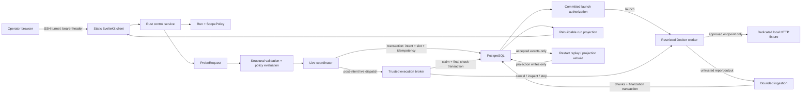

# NEORAPTOR Architecture

## Purpose and status

NEORAPTOR is a scaffold. The architecture and controls in this document are proposed designs, not implemented or independently verified capabilities. The product direction is governed offensive-security orchestration with reviewable execution and evidence. This restricted v0.1 milestone is one local-fixture workflow, not the complete long-term product.

See [product direction](product.md) for the destination and hypotheses, [milestones](plan/INDEX.md) for gated capability scope, [current status](plan/STATUS.md) for verified repository evidence, and the [canonical M1 protocol](m1-protocol.md) for selected deployment and execution decisions.

The design aims to provide operators with visible plans, action rationales, tool calls, results, and evidence links. It does not promise access to complete model-internal reasoning, production safety, complete vulnerability coverage, or superiority to other products.

## Proposed v0.1 scope

One authenticated operator in a controlled deployment can initiate a run for one dedicated local HTTP test fixture on an isolated test network. The request names an operator-configured fixture identifier; only trusted configuration maps that identifier to an approved endpoint. Neither the request nor a planner can redefine the endpoint.

The single supported capability is a predefined, read-only HTTP observation check. There are no arbitrary URLs or shell commands, public targets, exploitation, brute force, credential attacks, lateral movement, autonomous escalation, multi-agent attack chains, automatic redirects, or automatic target-facing retries. An HTTP observation can still produce server-side effects such as access logs; zero target-side effects are not guaranteed. Local fixtures are not automatically trusted or safe.

The intended vertical slice is:

```text
Authenticated API request
  -> ProbeRequest
  -> structural validation
  -> ScopePolicy evaluation
  -> durable ExecutionAttempt intent
  -> live dispatch to trusted execution broker
  -> acquire execution claim / active slot
  -> authoritative final permission check
  -> restricted worker launch
  -> bounded artifact capture
  -> CheckResult and separate evidence-completeness status
  -> rebuildable run projection and minimal inspection UI
```

A durable intent must be recorded before target-facing work. If persistence fails, new execution is blocked. On restart, replay reconstructs state and must never invoke the executor; an unresolved attempt is recorded as outcome unknown and is not automatically redispatched.

Every operator API request requires the selected bearer authentication; controlled network placement is not a substitute. M1 permits only one active target-facing attempt at a time. The browser client and credential flow are summarized in [frontend.md](frontend.md) and specified in the [M1 protocol](m1-protocol.md).

## Proposed logical boundaries

These are logical responsibilities, not a required distributed-actor or crate layout. M1 selects a dedicated Linux VM with a non-root control service and a separate privileged broker process.

- **Control plane:** Authenticates every operator API request with the selected bearer credential, creates a run-specific immutable `ScopePolicy` revision, validates request structure, evaluates policy, records accepted domain events, and serves the static client and minimal inspection interface. Multi-tenant security is not designed here.
- **Trusted execution broker:** Receives a distinct live dispatch command after durable intent. It acquires the deployment execution slot, claims the attempt, and performs the authoritative final permission check against the exact request, policy, fixture-configuration revision, and relevant execution-configuration revision before launching the restricted Docker worker. Its socket and caller boundary are specified in the canonical protocol. The broker is privileged and security-sensitive; it is not the untrusted tool sandbox.
- **Tool process/container:** Runs the single predefined HTTP observation check with restricted resources and egress. Its output and status messages are untrusted reports, not authoritative event writes or policy decisions.
- **Persistence:** PostgreSQL is selected for event history, metadata, coordination, and bounded artifact chunks. This is a proposed design; database roles, constraints, and durability assumptions are not implemented or independently verified.
- **Inspection UI:** A statically built SvelteKit client served by Rust presents bounded projections, attempt outcomes, readiness, and evidence. It treats raw artifacts as untrusted data and renders them inertly.

## Trust and data flow



The diagram describes a proposed boundary, not a deployed system. Intent is durably committed with admission/slot/idempotency state before separate live dispatch. The broker claim and final permission check are defined in the [M1 protocol](m1-protocol.md); the database/OS mechanisms remain unimplemented. Replay reads accepted facts to rebuild projections and cannot launch or contact targets. The fixture endpoint and execution configuration are fixed by trusted revisions; a change requires reevaluation. Docker alone does not enforce the allowlist. Inspect default-deny configuration and run representative negative reachability tests at the selected network boundary; those tests do not prove every possible destination unreachable.

## Authorization sequence

Structural validation checks syntax, bounds, the supported check type, and its parameter schema. It does not grant authorization. Policy evaluation decides whether the exact request is permitted by a specific immutable `ScopePolicy` revision. Approval binds that exact request to the policy, fixture/execution configuration revisions, and approved resource limits; matching run IDs or digests alone do not establish the binding. Immediately before target-facing work, the broker rechecks the current policy and revocation state, run state, exact request/approval identity, validity window, resource budget, fixture-configuration revision, and relevant execution-configuration revision using a trusted injectable clock. The selected authentication mechanism is the protected, expiring bearer credential described in the canonical protocol; no credential is claimed implemented.

The validity interval is half-open: `valid_from <= now < valid_until`. The conservative 15-second execution timer begins immediately before Docker start is issued, not on a later worker-start acknowledgement; policy expiry is an additional upper bound. See the [M1 protocol](m1-protocol.md) for the combined create/start budget, ambiguous operation handling, and bounded cancellation/shutdown phases. At expiry, initiate cancellation and bounded worker termination; do not imply an instantaneous stop or reversal of prior effects. An explicit timestamp makes policy checks testable but does not prevent time-of-check/time-of-use races. Authorization is per run, not fixed globally at process startup. Creating a new run may create a new policy revision; changing an approved policy creates a new revision rather than mutating its prior meaning. M1 has no waiting execution backlog: reject a distinct new start as busy, and cancel active work on revocation or expiry. A confirmed worker stop may coexist with an unknown execution outcome; retain the slot until stop/absence and required cleanup are established.

A platform approval record captures the operator's asserted authorization. It does not independently prove legal ownership or permission to test a third-party target. No `Clone` or `Arc` ownership pattern is a security boundary. Private fields can help preserve API invariants but do not replace runtime checks.

## Events, recovery, and failure behavior

Domain events record facts; replay applies facts to rebuild an explicitly derived projection and never launches workers, contacts targets, issues dispatch commands, or changes authorization. Rebuilding the projection store is permitted; it is not a second authority. A durable per-run sequence, not timestamps alone, establishes event order. PostgreSQL is selected; expected-revision/row-lock transaction requirements and durability limits are detailed in the canonical protocol and ADR-001. A dispatch-intent event records an intention, not proof that a worker started. Worker reports pass through authenticated control-plane ingestion and are validated before accepted events are appended.

If required persistence fails, stop new dispatch and trigger cancellation of active work under bounded termination; a failure event itself may not be persistable. On restart, reconcile workers owned by this deployment before dispatch is reenabled. Unresolved cleanup prevents new target execution. An unresolved dispatch intent is `OutcomeUnknown` unless explicit reconciliation evidence establishes its status. Reconciliation appends a new fact with actor identity and evidence; it does not overwrite the unknown-outcome event. Late worker reports cannot silently overwrite accepted history. v0.1 has no automatic target-facing retry. A manual retry requires explicit authorization and creates a new attempt while preserving prior history. Do not claim exactly-once or at-most-once external execution.

## Evidence and findings

Separate the live worker stream, bounded ingestion, persisted artifact bytes, and `ArtifactMetadata` referenced by events. The selected PostgreSQL chunk-staging/finalization protocol and proposed 10 MiB per-artifact and 100 MiB per-run caps are detailed in the [M1 protocol](m1-protocol.md) and [ADR-005](adr/ADR-005-output-size-caps.md). M1 permits one active target-facing attempt at a time, but ingestion/accounting must still remain correct under concurrency and recovery. A stream ending normally exactly at its cap may be complete. Observed excess is not retained; it marks capture incomplete, initiates attempt termination, and requires bounded cleanup. Incomplete evidence is distinct from an unknown execution outcome and cannot confirm a finding. Finding validation remains future capability.

Raw output, target pages, retrieved documents, and artifacts remain untrusted data, even after a finding is validated. Preserve raw capture separately from any sanitized/redacted view. A digest can detect mismatch against a trusted expected digest; it does not establish provenance or prevent a privileged attacker from rewriting both content and metadata. An HTTP observation is not itself a security finding; finding validation requires explicit check-specific criteria and may be inconclusive. Any future target-facing validation action is a new action subject to authorization and execution controls.

## Verification requirements

The designs are requirements, not claimed passing tests. Before executing against even the local fixture, verify at minimum:

| Requirement | Acceptance evidence |
|---|---|
| Permitted fixture execution | The configured fixture identifier reaches only the approved fixture. |
| Destination/capability denial | Other destinations and unsupported checks are rejected before worker invocation. |
| Request integrity | A changed request requires fresh authorization. |
| Expiry/revocation | Pre-launch permission failure is denied by the broker; expiry/revocation during execution initiates cancellation and bounded termination. |
| Persistence/recovery | Persistence failure blocks dispatch; crash after intent recovers as unknown; replay makes zero executor calls. |
| Duplicate handling | Duplicate request/attempt submissions follow explicit idempotency rules and do not silently create extra execution. |
| Evidence limits | Per-artifact and aggregate run caps hold under concurrent capture; incomplete observations are explicit, distinct from execution outcome, and cannot alone confirm a finding. |
| Shutdown/rendering | Shutdown meets its deadline with worker cleanup attempted; raw artifact rendering is safe. |

See [security.md](./security.md), [domain-model.md](./domain-model.md), [runtime.md](./runtime.md), and the [proposed testing strategy](./testing.md) for corresponding boundaries and verification requirements.

## Longer-term product direction and deferred work

Broader authorized testing remains the product direction, gated on security and reliability acceptance criteria. Additional targets, tools, agent/planner autonomy, escalation, chain planning, coverage models, snapshots, event migrations, advanced sandbox backends, and external integrations are deferred; none is a mandatory v0.1 workflow step. Domain/CIDR canonicalization and destination-resolution policy require a separate design before those target types are considered.

Logical modules may be separated later, but no crate layout is prescribed here. The [M1 protocol](m1-protocol.md) records selected mechanisms and remaining deployment-specific closure. This architecture is a summary; [testing](testing.md), [observability](observability.md), and the reviewed [ADR index](adr/README.md) provide the related proposed requirements.
